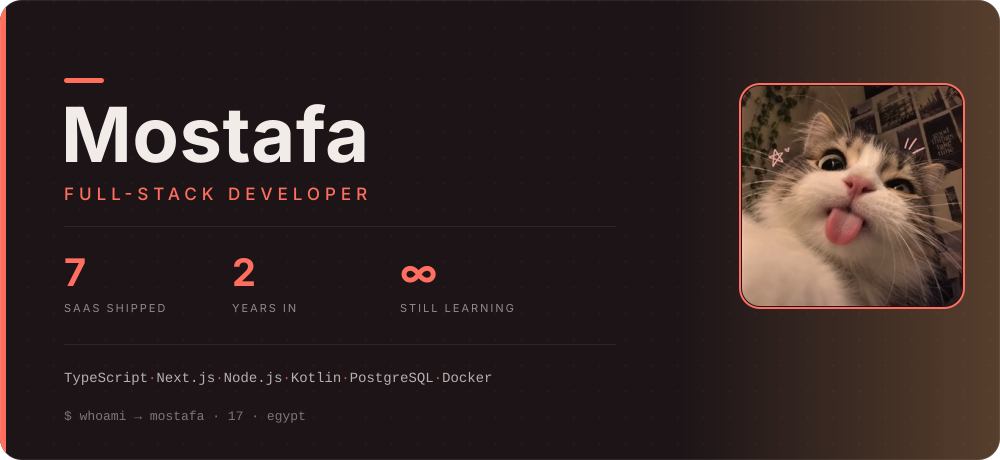

  

### 17 · Egypt · full-stack developer · 7 SaaS products shipped in two years

I build web products end-to-end — design, code, deploy, and the unglamorous middle nobody talks about: configs, environments, break-fix at 2am. Self-taught. Started at 15 playing with Node.js bots. Never stopped.

**Shipped**
- **7 SaaS products** in 2 years — each deployed, maintained, and iterated by me
- **WhatsApp bot frameworks** in Node.js — multi-instance, config-driven, long-lived sessions
- **Kotlin Android app** — a Quran shorts player, built for Arabic-first UX
- **Self-hosted panels** — pterodactyl-style, running in proot environments

**Working with:** TypeScript · Next.js · Node.js · Kotlin · PostgreSQL · Docker · Linux

**Currently:** product #8 · backend systems at scale — queues, caching, reliability

**Contact:** [mogamingcv7v@gmail.com](mailto:mogamingcv7v@gmail.com)
